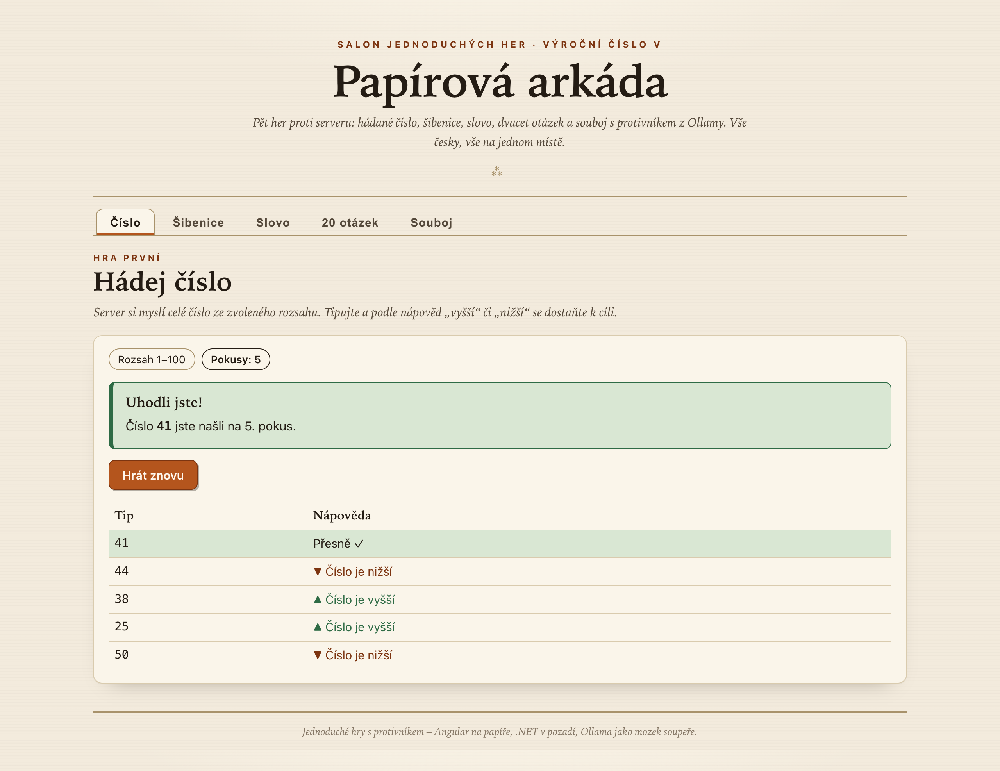
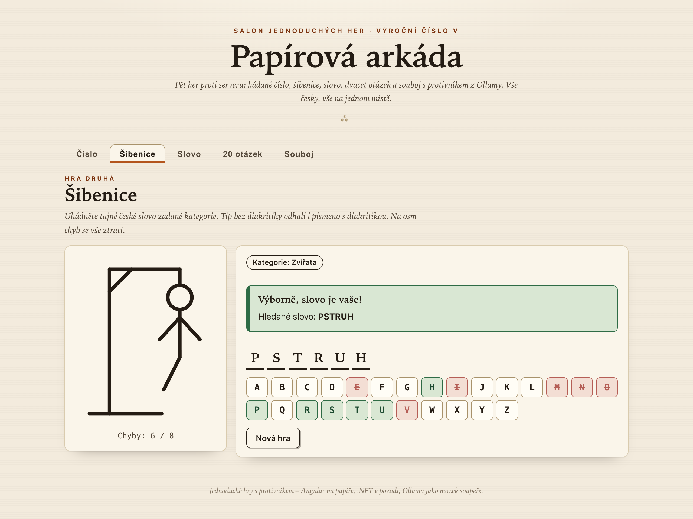
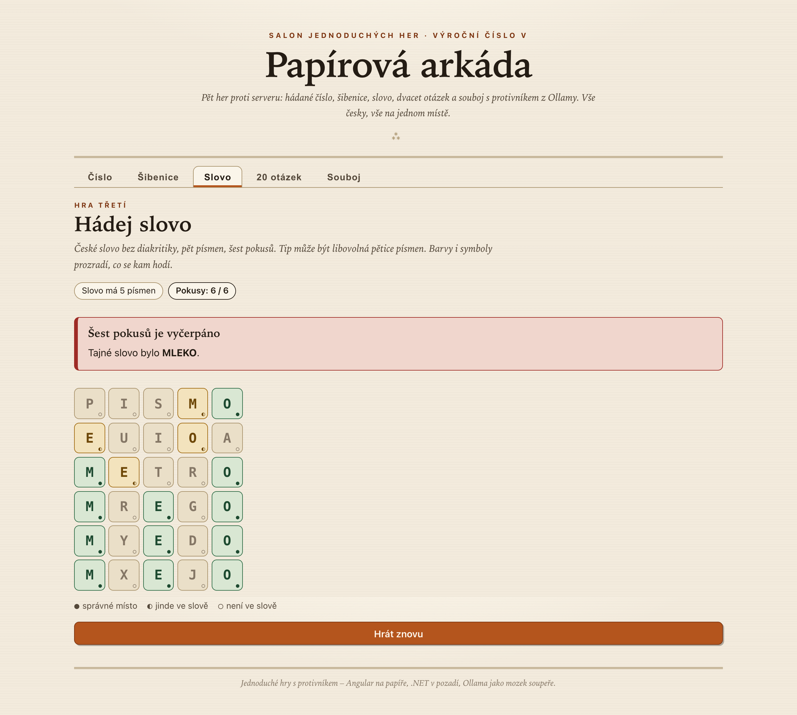
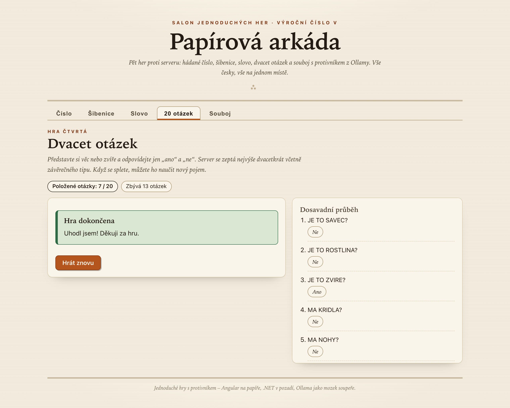
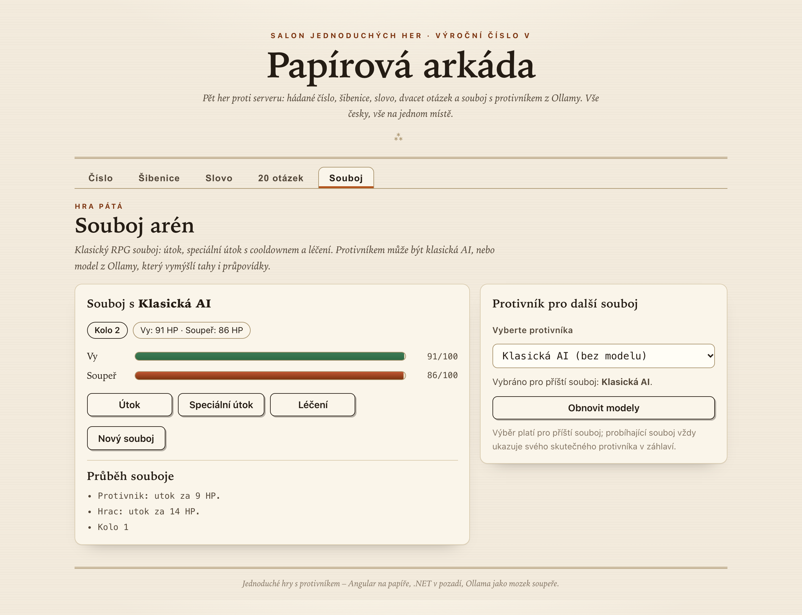

# Papírová arkáda

Šest jednoduchých her proti serveru, vše česky na jedné stránce: hádání čísla, šibenice,
hádání slova (Wordle), dvacet otázek s učením, RPG souboj, ve kterém může protivníka
ovládat decision model z Ollamy, a piškvorky 15×15, kde můžou obě strany hrát modely.

Stack: **ASP.NET Core (`.NET 10`, bez NuGet balíčků)** na pozadí a **Angular 22**
(standalone komponenty, signals) na papíře. Ollama je volitelná — bez ní hraje
protivník klasická heuristická AI.



| Hra | Pravidla v kostce |
| --- | --- |
| **Hádej číslo** | Server si myslí číslo z voleného rozsahu (výchozí 1–100, rozdíl mezí nejvýše 1 000 000). Nápovědy „vyšší“/„nižší“, neplatné tipy se nepočítají do pokusů. |
| **Šibenice** | Tajné české slovo z kategorie, osm chyb (progresivní SVG). Tip bez diakritiky odhalí i písmeno s diakritikou („s“ odhalí „Š“). Tajné slovo se prozradí až na konci. |
| **Hádej slovo** | Wordle ve stylu: 5 písmen, 6 pokusů, zpětná vazba po pozicích se správným počítáním duplicit (dvě stejná písmena ≠ dvě žlutá tajemství). |
| **20 otázek** | Server se ptá ano/ne, poslední položkou je i jeho tip (limit 20). Když se splete, naučíte ho: nový pojem + otázka, která je pro něj ANO a pro marný tip NE. Naučený strom zůstává (v paměti serveru) i pro další hry. |
| **Souboj (RPG)** | Tla na tlač: útok (10–18), speciální útok (20–30, 30 % minout, cooldown 3 kola) a léčení (15–25). Protivník: klasická heuristika nebo decision model z Ollamy (tah + rozdělení pravděpodobností), který při selhání čitelně spadne na heuristiku. |
| **Piškvorky** | Gomoku 15×15: pět v řadě vyhrává (řádek, sloupec, diagonála), X začíná. Režim X i O (člověk nebo model z Ollamy) se volí při startu, povolen je i model proti modelu. Model sahá přes strukturovaný chat; po třech marných pokusech tah viditelně převezme záchranná heuristika. |



## Spuštění lokálně

Požadavky: [.NET 10 SDK](https://dotnet.microsoft.com/) a Node.js (stačí 20.11+;
frontendové skripty si přes `npx` samy dočasně zajistí Node 22). Volitelně běžící
[Ollama](https://ollama.com/) na `localhost:11434`.

```bash
# 1) API na portu 5183
dotnet run --project SimpleGame --launch-profile http

# 2) Webové rozhraní na portu 4200 (proxy /api → 5183)
npm install --prefix simple-game-ui
npm start --prefix simple-game-ui
```

Pak stačí otevřít <http://localhost:4200>.

### Ollama (volitelné)

API čte nainstalované modely z Ollamy (`GET /api/llm/models`) včetně jejich
capability (`decision`, `vision`, …) a tahy modelů posílá ve dvou protokolech: v RPG
souboji s protivníkem rozhodujícím přes decision režim zasílá na `POST /v1/systemone`.
Dotaz obsahuje herní stav (kolo, HP, cooldowny, poslední akce hráče a poslední tři
řádky logu) a dvě pojmenované otázky — `akce` = `choice` s kritérii jen pro **povolené
akce** (`attack` / `special` / `heal`), ze kterých model vybere jednu a vrátí i rozdělení
pravděpodobností a jistotu, a `ohrozeni` = `noul` („je hráč v ohrožení?“ s
pravděpodobností). Tah v piškvorkách (`row` + `col`) zasílá na `POST /api/chat` s
vynuceným schématem odpovědi, bez streamování a bez „thinking“ bloků. Nastavení je v
`SimpleGame/appsettings.json` (sekce
`Ollama`: `BaseUrl`, časové limity 3 s pro seznam modelů, 10 s pro rozhodnutí a 45 s pro
tah, `KeepAlive`). Zásadní chování:

- seznam modelů se kešuje (30 s dostupná Ollama, 3 s nedostupná, tlačítko v UI aktualizuje hned);
- v souboji lze zvolit jen decision model ze seznamu; nedostupná Ollama = `503`,
  neexistující model = `400`, model bez capability `decision` = `400`;
- v piškvorkách lze pro X i O zvolit lidského hráče nebo model; nedostupná Ollama = `503`,
  a když model po třech pokusech nevrátí volné pole (neodpoví, vrátí neplatné souřadnice
  nebo obsazené pole), tah čitelně převezme záchranná heuristika s důvodem;
- v souboji: když model někdy neodpoví, vrátí akci mimo povolené akce nebo vrátí
  neplatné rozhodnutí, tah čitelně převezme klasická heuristika (v protokolu souboje je důvod);
- server rozlišuje `HTTP 400` (model neumí decision režim / chat), `HTTP 404` (model není
  nainstalovaný) a timeout — u všech případů je v logu konkrétní důvod fallbacku.

### Docker

`docker compose up --build` postaví API image a zpřístupní ji na portu **5183**.
Ollama se ze kontejneru hledá na `host.docker.internal:11434` (lze přepsat proměnnou
`OLLAMA_BASE_URL`). Webový kontejner není součástí compose — frontend provozujte
`npm start`, nebo obsah `simple-game-ui/dist` naservírujte vlastním webovým serverem
(api neobsahuje statické soubory).

## Testy

```bash
dotnet test SimpleGame.slnx                  # 172 backendových testů (xUnit)
npm test --prefix simple-game-ui             # 35 UI testů (vitest, spustí jednou)
```



## API

Všechny odpovědi her jsou „ploché“ pohledy včetně `id` relace; chyby mají jednotný
tvar `{ "code": ..., "message": ... }` (400 neplatný vstup, 404 neexistující/vypršelá
hra, 409 konflikt, 429 limit relací, 503 nedostupná Ollama/zastavující server).

| Metoda | Cesta | Popis |
| --- | --- | --- |
| GET | `/api/health` | zdravotní kontrola |
| GET | `/api/llm/models` | seznam modelů Ollamy včetně capability |
| POST | `/api/games/number/start`, `/number/{id}/guess` | nová hra a tip |
| POST | `/api/games/hangman/start`, `/hangman/{id}/guess` | nová hra a písmeno |
| POST | `/api/games/word/start`, `/word/{id}/guess` | nová hra a tip |
| POST | `/api/games/twenty/start`, `/twenty/{id}/answer`, `/twenty/{id}/verdict`, `/twenty/{id}/teach` | otázka, hodnocení tipu, učení |
| POST | `/api/games/rpg/start`, GET `/rpg/{id}`, POST `/rpg/{id}/action` | souboj |
| POST | `/api/games/piskvorky/start`, GET `/piskvorky/{id}`, POST `/piskvorky/{id}/move` | piškvorky (tah modelu se posílá s `position: null`) |

## Poznámky k implementaci

- Relace her žijí jen v paměti (výchozí max 1000 relací, výchozí nečinnost
  2 hodiny; konfigurace v sekci `Sessions`). Restart serveru hry zahodí —
  UI na to reaguje srozumitelnou chybou a nabídkou nové hry.
- RPG kolo je **atomické**: tah hráče i tah protivníka se propočítají na kopii stavu
  a potvrdí najednou (`revision`); GET během kola vrací poslední potvrzený stav,
  souběh tlačítek řeší 409 a UI po selhání sítě nabízí obnovu stavem, ne opakovaný POST.
- Dvacet otázek sdílí jeden strom: každá hra hraje na neměnném snímku, učení
  publikuje nový kořen a současná lekce u stejného listu dostane 409, aby si hry
  nepřepisovaly lekce navzájem.
- Tip bez diakritiky funguje i pro slova s diakritikou (normalizace Unicode FormD).



